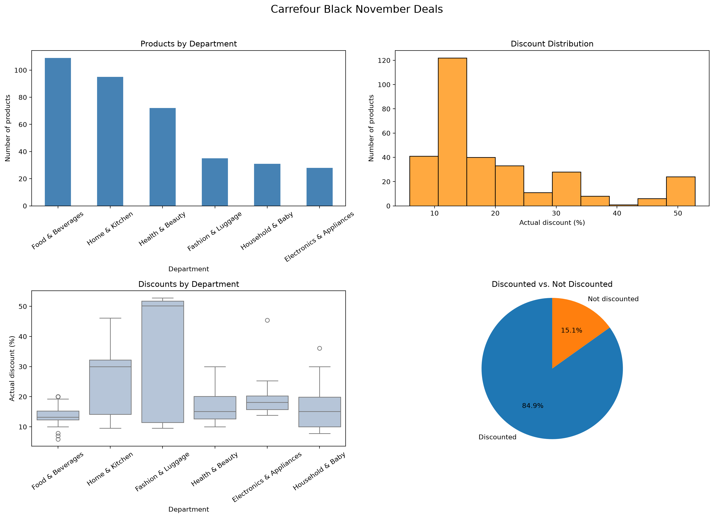

# Carrefour Kenya Black November Deals

An exploratory analysis of Carrefour Kenya's Black November product promotions. The project compares discounts by department and delivery type, and looks at both percentage discounts and cash savings in KES.

## Key findings

- **Food & Beverages** had the largest assortment: 109 of 370 products (29.5%).
- **Fashion & Luggage** had the highest average actual discount by department. Its Express products averaged 47.1%, the highest department–delivery combination.
- The most common discount interval was 10.6%–15.3%, covering 122 products.
- The largest cash saving was KES 26,502 on the Von Fridge VARZ-20NHK.

## Dashboard



See [the final report](reports/final_report.md) for the charts and findings.

## Data and methods

The analysis uses a snapshot of 370 de-duplicated product listings captured on 11 November 2026. Prices are in Kenyan shillings (KES). The raw CSV is kept locally in `data/raw/` and is not included in this repository.

- **Actual discount (%)** = (original price − current price) ÷ original price × 100
- **Savings (KES)** = original price − current price

The analysis treats “best deal” in two ways: percentage discount measures relative savings, while KES saved measures the cash amount. The results describe the promotion snapshot, not purchases or price trends over time.

## Run the analysis

Use Python 3.14 and install the dependencies:

```powershell
# Create the project virtual environment.
py -V:3.14 -m venv .venv

# Install the required libraries.
.\.venv\Scripts\python.exe -m pip install -r requirements.txt
```

Place the provided CSV in `data/raw/`, then open the notebook in `notebooks/` using the project's `.venv` kernel.

## Project structure

- `data/raw/` — local source CSV; excluded from Git
- `data/processed/` — prepared data
- `notebooks/` — analysis notebook
- `outputs/figures/` — saved charts
- `reports/` — final report
- `requirements.txt` — Python dependencies